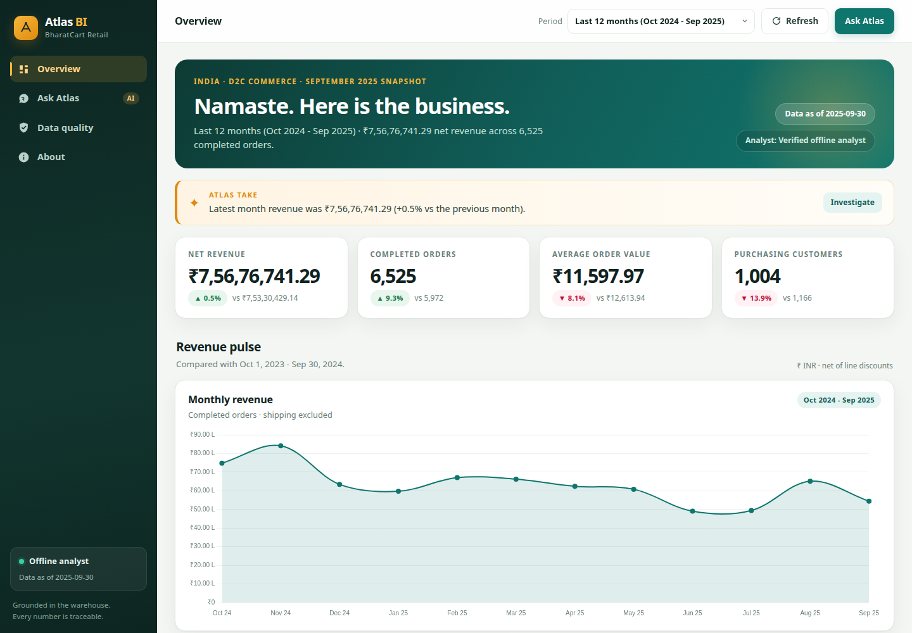
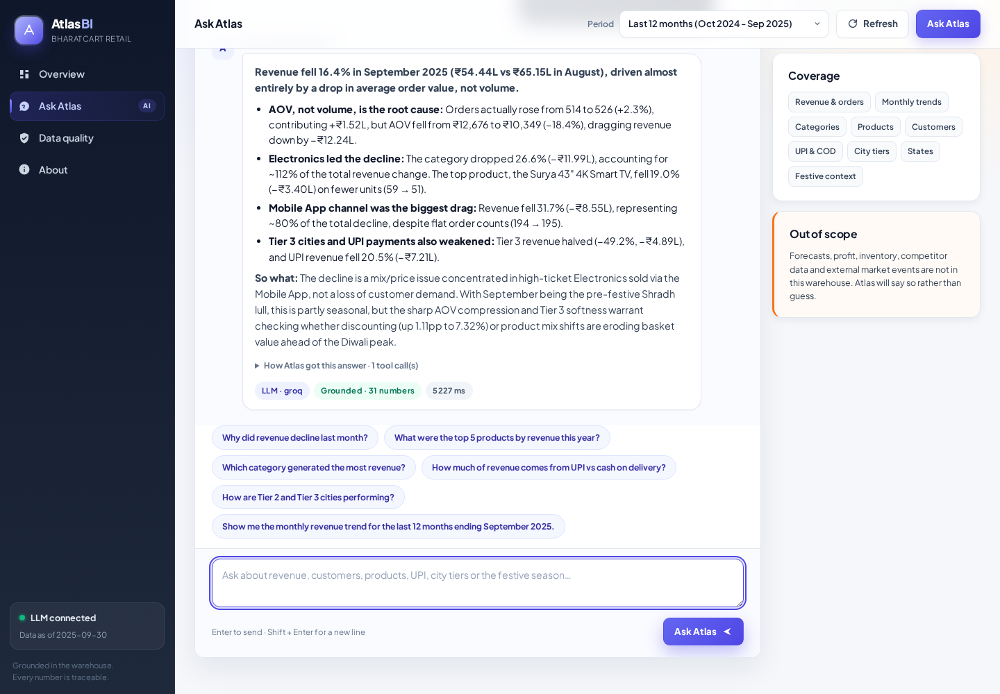
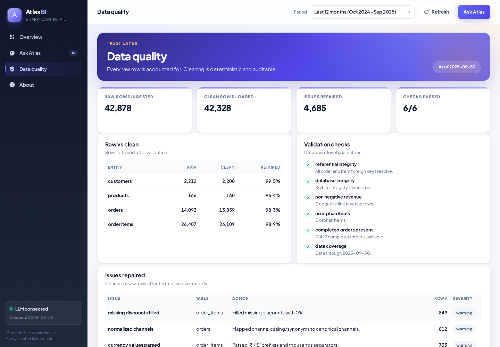

# Atlas BI — AI Data Analyst & Business Intelligence Agent

> An autonomous, grounded AI analyst for an **Indian e-commerce retailer**. It turns messy commerce exports into a trustworthy SQLite warehouse, answers plain-English business questions through controlled tool calling, and renders a responsive dashboard with charts and AI-style insights.

**Candidate:** Pramit Das · **Assignment:** DDL Labs Technical Assignment · **Repository:** `github.com/pramit-webdev/ddl-labs-ai-data-analyst`

**Live demo:** https://atlas-bi.onrender.com (Render free tier — first request after sleep may take a few seconds)

---

## 1. What this product does

Atlas BI is a full-stack application, not a collection of scripts:

```
Raw CSVs → deterministic cleaning → SQLite warehouse → analytics service
        → controlled tools → LLM (or deterministic planner) → grounding check
        → API → rendered dashboard + grounded chat
```

A real user can:

- open a dashboard and see verified KPIs and charts,
- switch reporting periods (latest month, last 30/90 days, last 12 months, YTD, all time),
- ask questions such as *"Why did revenue decline last month?"* and get a multi-step root-cause diagnosis,
- ask about **UPI vs COD**, **Tier 2 / Tier 3 cities**, **top Indian states**, channels, products and customers,
- request a chart and see it rendered in chat,
- inspect the data-quality report that explains every repair made to the raw data.

Every number displayed is computed from the warehouse. The LLM never sees the database directly and every answer passes a numeric grounding check before it is shown.

---

## 2. India-first product decisions

The dataset and product are deliberately India-centric:

| Dimension | How it is modelled |
|---|---|
| Business | Fictional retailer **BharatCart Retail** |
| Currency | Indian Rupees (₹) with Indian digit grouping (`₹54,43,685.86`) and Cr/Lakh compact forms |
| Geography | 29 Indian cities across Tier 1 / Tier 2 / Tier 3, plus small NRI populations |
| Payments | UPI (~56% of revenue), cards, Cash on Delivery, Net Banking, wallets |
| Channels | Mobile App, Website, Marketplace, WhatsApp, Retail Store |
| Catalogue | Indian brands and products — Surya TVs, Rangoli kurtas, Basmati rice, Kashmir willow bats, Channapatna toys |
| Seasonality | Diwali peak in Oct–Nov, wedding season Jan–Feb, monsoon Jun–Jul, **pre-Diwali Shradh lull in September** |
| The core story | September 2025 revenue fell **16.4%** from August even though orders rose **2.3%** — a mix shift away from high-ticket electronics, reinforced by festive-calendar context |

The snapshot ends on **2025-09-30**. All period logic is anchored to the latest date in the warehouse, so the demo stays stable over time.

---

## 3. Quickstart

### Requirements

- Python 3.11+ (tested on 3.12)
- No Node.js build step — Chart.js is vendored locally

### Run

```bash
git clone https://github.com/pramit-webdev/ddl-labs-ai-data-analyst.git
cd ddl-labs-ai-data-analyst
python -m venv .venv && source .venv/bin/activate
pip install -r requirements.txt

# Generate raw CSVs + independent expected-metrics oracle
python scripts/generate_sample_data.py

# Clean them into data/warehouse.db (also happens automatically on first start)
python -m app.ingest

# Start the app
python -m uvicorn app.main:app --reload
```

Open **http://127.0.0.1:8000**.

Interactive API docs: **http://127.0.0.1:8000/docs**

### Without a key

The app runs in **verified offline mode** out of the box. The deterministic planner classifies the question, calls the same controlled tools, and formats answers from tool output. No external service is required.

### With an LLM

Copy `.env.example` to `.env` and add a real key:

```bash
cp .env.example .env
# edit .env
LLM_PROVIDER=groq
LLM_API_KEY=gsk_...
LLM_MODEL=qwen/qwen3.8-27b   # optional; provider default is used if blank
```

Supported OpenAI-compatible providers: `groq`, `nvidia`, `openai`, `openrouter`, `custom` (set `LLM_BASE_URL`), and `offline`.

The LLM is used in a tool-calling loop. If the provider is unavailable, returns an ungrounded answer, or exceeds the step budget, the app automatically falls back to the deterministic analyst and tells the user why. The API key is never exposed to the frontend.

---

## 4. Verified dataset

`data/raw/*.csv` is intentionally dirty but deterministic. `python -m app.ingest` repairs it into a clean star schema and writes `data/quality_report.json`.

| Entity | Raw rows | Clean rows |
|---|---:|---:|
| Customers | 2,212 | 2,200 |
| Products | 166 | 160 |
| Orders | 14,093 | 13,859 total / **12,497 completed** |
| Order items | 26,407 | 26,109 total / **23,489 completed** |

Repairs include duplicate removal, `₹`-prefixed money parsing, `DD/MM/YYYY` dates, status/case normalisation, UPI/COD aliases, city-tier aliases, blank discounts, negative quantities and orphan foreign keys. All six integrity checks pass.

**Revenue definition:** net product revenue from completed orders only — `quantity × unit_price × (1 − discount%)`. Shipping and taxes are excluded; cancelled, returned and pending orders are excluded.

### Independent oracle

`data/expected_metrics.json` is computed by the generator *before* dirt is injected, independently of the SQL path. Tests compare the warehouse against it.

| Metric | Value |
|---|---:|
| All-time revenue | ₹15,10,07,170.57 |
| All-time completed orders | 12,497 |
| Latest month (Sep 2025) revenue | ₹54,43,685.86 |
| Previous month (Aug 2025) revenue | ₹65,15,447.83 |
| Month-on-month change | **−16.4%** |
| Orders change | **+2.3%** (514 → 526) |
| AOV change | **−18.4%** (₹12,675.97 → ₹10,349.21) |
| Top product | Surya 43" 4K Smart TV |
| Top category | Electronics (~67% of revenue) |
| UPI share | ~56% of revenue |

Small cent-level differences between the oracle and SQL arise from per-line rounding and are covered by test tolerance.

---

## 5. Multi-step decline analysis

`GET /api/analysis/revenue-decline` implements the assignment's required *"Why did revenue decline last month?"* journey:

1. **Headline** — revenue, orders, customers and AOV for the month vs the prior month.
2. **Decomposition** — `ΔRevenue ≈ ΔOrders × prior AOV + ΔAOV × current orders`. For Sep 2025: volume `+₹1,52,111.62`, AOV `−₹12,23,873.59`.
3. **Category / product / channel / segment drivers** — Electronics contributed `−₹11,98,951.26` (≈112% of the decline, because other categories grew).
4. **Payment and city-tier drivers** — UPI/card/COD movement and Tier 1/2/3 mix.
5. **Churn signal** — high-value customers who purchased in August but not September.
6. **Calendar context** — the pre-Diwali Shradh lull explains part of the high-ticket pause.

The answer is assembled from these tool results, not from free-text model memory.

---

## 6. Architecture

```
app/
├── config.py          # env-driven settings, provider defaults
├── db.py              # SQLite schema, views, repository, metadata
├── ingest.py          # cleaning pipeline + data-quality report
├── analytics.py       # all business metrics, periods, charts, insights
├── errors.py          # domain errors mapped to clean API responses
├── main.py            # FastAPI endpoints + static dashboard
├── agent/
│   ├── llm.py             # OpenAI-compatible chat client with retries
│   ├── tools.py           # controlled tool registry + JSON schemas
│   ├── query_guard.py     # read-only SQL allow-list + authorizer
│   ├── grounding.py       # numeric claim verification
│   ├── planner.py         # deterministic intent router and answers
│   └── orchestrator.py    # tool loop, fallbacks, suggested questions
└── static/            # index.html, styles.css, app.js, vendored Chart.js
scripts/
├── generate_sample_data.py
tests/
├── test_ingest.py, test_analytics.py, test_agent.py, test_api.py
└── e2e/test_dashboard.py
```

### Controlled tools

| Tool | Purpose |
|---|---|
| `get_sales_metrics` | Revenue, orders, customers, AOV with comparison |
| `get_monthly_revenue` | Monthly trend |
| `get_revenue_by_category` | Category breakdown |
| `get_top_products` / `get_low_performing_products` | Product leaders and laggards |
| `get_customer_metrics` / `get_inactive_customers` / `get_top_customers` / `get_customer_trend` | Customer analytics |
| `get_payment_mix` / `get_city_tier_mix` / `get_channel_performance` / `get_top_states` | India-specific dimensions |
| `get_revenue_decline_analysis` | Multi-step root-cause diagnosis |
| `generate_chart` | Chart spec built from real data |
| `query_data` | Guard-railed `SELECT`/`WITH` over allow-listed objects only |

`query_data` rejects comments, multiple statements, writes, restricted tables and dangerous functions, enforces a `LIMIT`, and uses a SQLite authorizer plus a 2-second progress deadline.

### Grounding

Every numeric token in the final answer (currency, percentage, count) is extracted and compared with numbers present in tool results and the user's question. Years, period labels such as "last 12 months", and small list-count integers are ignored. If any material figure is ungrounded, the model is asked to correct it; a second failure triggers the deterministic fallback.

---

## 7. API

| Method | Endpoint | Description |
|---|---|---|
| GET | `/api/health` | Database and LLM status |
| GET | `/api/meta` | Business context, periods, suggested questions |
| GET | `/api/overview?period=` | All dashboard data in one response |
| GET | `/api/kpis?period=` | KPI values with deltas |
| GET | `/api/charts/{monthly-revenue,revenue-by-category,top-products,customer-trend,payment-mix,city-tier,channel}` | Chart specs |
| GET | `/api/products/top`, `/api/products/low` | Product rankings |
| GET | `/api/customers/metrics`, `/api/customers/inactive`, `/api/customers/top` | Customer analytics |
| GET | `/api/payments`, `/api/city-tiers`, `/api/channels`, `/api/states` | India-specific breakdowns |
| GET | `/api/analysis/revenue-decline?month=` | Multi-step decline analysis |
| GET | `/api/quality` | Cleaning report and checks |
| POST | `/api/ask` | Grounded analyst answer (`{"question": "..."}`) |
| GET | `/api/examples` | Suggested questions |

All domain errors return a stable shape: `{"error": {"code", "message", "details"}}`.

---

## 8. Tests

```bash
pytest -q                         # unit, integration and browser E2E
pytest -q -m "not e2e"            # skip browser tests
BASE_URL=http://127.0.0.1:8000 pytest -q -m e2e
```

- **Unit / integration:** ingestion vs oracle, analytics, currency formatting, periods, decline decomposition, tool validation, SQL guard, grounding, planner classification, API contracts.
- **Playwright E2E:** overview rendering, period switching, grounded chat answer, in-chart rendering, quality page, unsupported question and mobile overflow/layout.

The suite covers all 51 tests passing at submission time, including a scripted LLM tool-loop test and a grounding-failure fallback test.

---

## 9. Screenshots

### Overview dashboard



### Grounded analyst chat



### Data quality



---

## 10. Demo video

**Watch the demo:** [Atlas BI demo video (MP4, 68s)](https://github.com/pramit-webdev/ddl-labs-ai-data-analyst/releases/download/demo-v1/demo.mp4)

The recording shows the running application with the **live Groq tool-calling path**: overview dashboard, period switching, the "Why did revenue decline last month?" diagnosis with tool trace and grounding badge, and the data-quality page.

---

## 11. Submission details

| Field | Value |
|---|---|
| Candidate Name | Pramit Das |
| GitHub Repository | https://github.com/pramit-webdev/ddl-labs-ai-data-analyst |
| Demo Video | See section 10 |
| LLM Used | Groq `qwen/qwen3.8-27b` via OpenAI-compatible tool calling (automatic verified-offline fallback when no key is configured) |
| Database Used | SQLite (`data/warehouse.db`) built from deterministic raw CSVs by `app/ingest.py` |
| Main Technologies | Python 3.12, FastAPI, SQLite, pandas/numpy, OpenAI-compatible tool calling, Playwright, vanilla HTML/CSS/JS, Chart.js |
| Known Limitations | Synthetic dataset; no profit/inventory/forecast data; revenue excludes shipping and taxes; external market benchmarks unsupported |

---

## 12. Free deployment

Yes — the app is designed to run on a free tier. It needs no build step, no paid database and no persistent disk: the SQLite warehouse is rebuilt from committed CSVs on every cold start.

### Option A — Render (simplest)

1. Push this repo to GitHub (already done).
2. Create a **Render → Web Service** and connect the repo. Render reads `render.yaml` automatically.
3. In the dashboard, set the secret `LLM_API_KEY=gsk_...` (never commit it).
4. Deploy. Render exposes `PORT`, and the start command rebuilds the warehouse before launching Uvicorn.
5. Health check: `/api/health`.

This project is already deployed at **https://atlas-bi.onrender.com** using this configuration.

### Option B — Hugging Face Spaces (Docker SDK)

1. Create a new **Space → Docker → Public**.
2. Add a Space **Secret** named `LLM_API_KEY`.
3. Optionally set `LLM_PROVIDER=groq` and `LLM_MODEL=qwen/qwen3.8-27b` as Space variables.
4. Push this repo to the Space. The included `Dockerfile` exposes port `7860`.

### Option C — any Python PaaS / VPS

```bash
pip install -r requirements.txt
python -m app.ingest
uvicorn app.main:app --host 0.0.0.0 --port $PORT
```

Set `LLM_API_KEY` in the platform's secret manager. `HOST` and `PORT` are read from the environment.

### Free-tier caveats

- Free instances usually **sleep after inactivity**; the first request after a cold start can take a few seconds while the warehouse rebuilds.
- Do not expect a persistent database — none is required.
- LLM rate limits still apply; the app falls back to the verified deterministic analyst if the provider is unavailable or throttled.
- Free-tier quotas change; check the provider's current terms before relying on them for production.

---

## 13. Honest limitations

- The data is a deterministic **synthetic** dataset created for this assignment, not real company data.
- Profitability, inventory, returns cost and external market data are not in scope.
- Forecasts and competitor benchmarks are intentionally unsupported — Atlas says so rather than guessing.
- The LLM path needs a provider key; without one the app uses the verified deterministic planner.
- `data/warehouse.db` and `data/quality_report.json` are generated at runtime and gitignored; raw CSVs and the expected-metrics oracle are committed.

---

## 14. Security notes

- No secrets are committed; `.env` is gitignored and `.env.example` contains only placeholders.
- The LLM only receives tool schemas and tool results — never raw database credentials.
- SQL tool access is read-only, allow-listed, limited and time-bounded.
- The frontend never receives the API key; LLM status is reported without secrets.
- Backend validation and authorization are not applicable to this single-user demo, but all input paths are validated.

---

*Built as a working product — from raw CSV to rendered, verified answer.*
